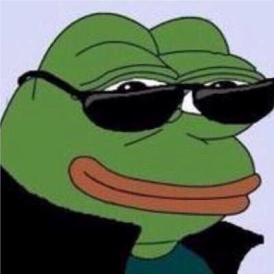

Hi! I'm Sanchay A/L Ravindran, a third-year Software Engineering student.

I hope to improve my understanding of software maintenance and evolution through this course. I'm looking forward to learning how to maintain existing software, improve code quality, and apply what I learn through practical activities.

- **Fun fact:** I enjoy sleeping.
- **Course expectations:** To gain practical experience in maintaining, improving, and evolving software systems.

